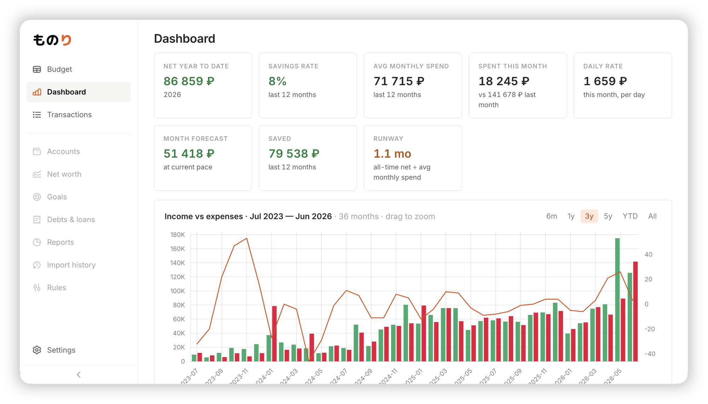

# monori

monori is a self-hosted, single-user **envelope budgeting** app — the YNAB-style workflow of a spreadsheet budget, rebuilt as a fast web app. It keeps the exact math of the Google Sheets budget it grew from, and adds inline editing, bank-statement import with auto-categorization, a full-year budget grid, and a dashboard with analytics. All money is stored as integer kopecks/cents end to end, so there is no floating-point rounding anywhere.

## Documentation

Full docs live in [`docs/`](docs/README.md):

- [Getting started](docs/getting-started.md) — run locally or deploy with Docker.
- [Configuration](docs/configuration.md) — environment variables and the database.
- [Budgeting](docs/budgeting.md) — the envelope model and the budget grid.
- [Transactions](docs/transactions.md) and [Importing statements](docs/importing.md).
- [Dashboard & analytics](docs/dashboard-analytics.md).
- [REST API](docs/api.md) and [Data model](docs/data-model.md).
- [Development](docs/development.md) — the stack, the `make` targets, testing.

### Optional single sign-on (OIDC)

Register a confidential OpenID Connect client with a strict redirect URI of
`https://<monori-host>/oidc/callback`. Enable authorization code, PKCE S256,
client secret basic authentication and RS256 signing. Allow the `openid`,
`profile` and `email` scopes and include identity claims in the ID token.
For authentik, use the issuer from the application's discovery document,
including its trailing slash, and restrict application access to the intended group.

Set `MONORI_OIDC_ISSUER`, `MONORI_OIDC_CLIENT_ID`, `MONORI_OIDC_CLIENT_SECRET`
(from a secret store) and `MONORI_OIDC_REDIRECT_URI` on the **backend**. Restart
it, then check `/api/auth/oidc/status` for `{"enabled":true}`. Incomplete
configuration hides the SSO button; password sign-in remains available.

For an existing budget, sign in with your password, go to **Settings → Account →
Link SSO to this account** and complete the provider prompt. Sign out and use
**Sign in with SSO** to verify that the same budget opens. Matching email alone
never links accounts. Automatic creation requires a verified, unused email;
otherwise register or sign in with a password first and explicitly link SSO.

For a closed installation, set `MONORI_SSO_ONLY_USER_IDS` on the backend to a
comma-separated allowlist of existing, already-linked Monori user IDs. This
turns off password login, registration, new account provisioning and self-service
linking. Only OIDC-issued sessions for listed IDs are accepted. Existing sessions
from before the switch must sign in again. An empty value denies everyone;
unset the variable to restore the optional SSO policy. No user data is deleted.
